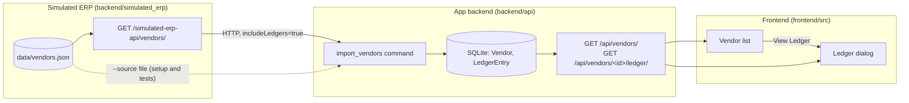

# Accounts Payable vendor ledgers

A small accounts payable (AP) app for a restaurant group, Harbor & Vine. It
pulls vendors and their ledgers (invoices, credit memos and payments) from the
group's ERP (accounting system) and shows what is owed to each vendor.

## Background

Ottimate automates accounts payable for restaurant groups and other
multi-location businesses. This repo is a much smaller app in the same space,
built for this exercise.

**The customer.** Harbor & Vine runs four restaurants in the San Francisco Bay
Area: Embarcadero, Mission, Oakland and Sausalito. About a dozen vendors supply
them: produce, seafood, dairy and bakery suppliers, a broadline food
distributor, beverage and wine distributors, paper goods, linen service,
kitchen repairs, pest control and utilities.

**How money flows**

1. A vendor delivers goods or a service and sends an invoice, due after the
   vendor's payment terms (Net 30 means 30 days after the invoice date).
2. The AP team enters the invoice in the ERP and codes it to a GL account (the
   expense account, such as 5000 Food Cost) and to the location it was for.
3. If a delivery is short or damaged, the vendor issues a credit memo that
   reduces what is owed.
4. Every couple of weeks AP runs payments (check or ACH). Each payment says
   which invoices it pays.
5. Sometimes a check is voided and reissued.
6. This app imports all of it from the ERP and shows what is owed to each
   vendor.

**Who uses this app.** The AP team and the controller. The ERP is their system
of record; this app reads from it and answers the questions they ask every
day: what do we owe each vendor, how did we get there, and what did it look
like on a given date?

**Terms used in the code**

| Term | Meaning |
|---|---|
| ERP | The customer's accounting system. Here, a simulated API (`backend/simulated_erp/`). |
| Vendor | A supplier Harbor & Vine buys from |
| Invoice | A bill from a vendor. Increases what is owed. |
| Credit memo | A credit from a vendor, for returns, short shipments or pricing errors. Reduces what is owed. |
| Payment | Money paid to a vendor. Reduces what is owed. |
| Balance owed | Invoices − credit memos − payments. Negative means the vendor owes us a credit. |
| Payment terms | Days from invoice date to due date |
| GL account | General ledger account: the expense category an invoice is coded to |
| Location | Which restaurant an invoice is for |

## Stack

- **Backend:** Django + Django REST Framework, SQLite (`backend/`)
- **Frontend:** React (`frontend/`)
- **ERP:** a simulated integration API served from a fixed data file
  (`backend/simulated_erp/`, spec in [`API_SPEC.md`](backend/simulated_erp/API_SPEC.md))



## Orientation

Before changing anything, get to know the app. Use your AI, your editor,
whatever works for you, then explain it back to your interviewer: what data
comes in, how a vendor's balance is worked out, and where the rules live.
Some questions to be able to answer:

- What does a negative payment mean here?
- Why is Coastal Ice Co.'s balance a dash and not $0.00?
- What happens if the ERP drops an entry?

## The task

Implement the tickets in [`tickets/`](tickets/README.md) using your preferred
AI tools. Your interviewer will tell you which ticket to start with.

| Ticket | Summary | Estimate |
|---|---|---|
| [AP-101](tickets/AP-101-flag-duplicate-invoices.md) | Flag possible duplicate invoices | S |
| [AP-102](tickets/AP-102-spend-by-gl-and-location.md) | Spend by GL account and location | S |
| [AP-103](tickets/AP-103-ap-aging-report.md) | AP aging report | M |
| [AP-104](tickets/AP-104-erp-payment-discounts.md) | Support payment discounts from the ERP | M |
| [AP-105](tickets/AP-105-vendor-statement-reconciliation.md) | Reconcile against vendor statements | M |

Use whatever AI assistant you normally work with. We are as interested in how
you understand the code, check the AI's output and test your changes as in the
finished feature, so talk us through what you're doing.

## Getting started

Requires Python 3.11+ and Node 20+. Or open the repo in its Dev Container
(`.devcontainer/`), which runs the setup for you.

```bash
./bootstrap.sh   # venv, dependencies, database, seed data, ERP import
./start.sh       # backend http://127.0.0.1:8009, frontend http://localhost:3009
```

`./reset_db.sh` deletes the database and rebuilds it from the ERP data.

## Importing from the ERP

```bash
cd backend
../.venv/bin/python manage.py import_vendors            # from the ERP API (server must be running)
../.venv/bin/python manage.py import_vendors --source simulated_erp/data/vendors.json
../.venv/bin/python manage.py import_vendors --dry-run  # report changes, write nothing
```

The import matches vendors on their ERP id, is safe to run again, and leaves a
vendor untouched if any entry in its ledger is invalid. `vendors.json` is
generated data, one ledger entry per line.

## API

| Endpoint | Returns |
|---|---|
| `GET /api/vendors/` | Vendors with the balance owed to each. Optional `as_of` (`YYYY-MM-DD`). |
| `GET /api/vendors/<id>/ledger/` | One vendor's entries, oldest first, with a running balance and totals. Optional `start`, `end`. |
| `GET /api/ledger-entries/?vendor=<id>` | Raw ledger entries |
| `GET /simulated-erp-api/vendors/?includeLedgers=true` | The simulated ERP |

## Tests

```bash
(cd backend && ../.venv/bin/python -m pytest)
(cd frontend && npm test -- --watchAll=false)
```
